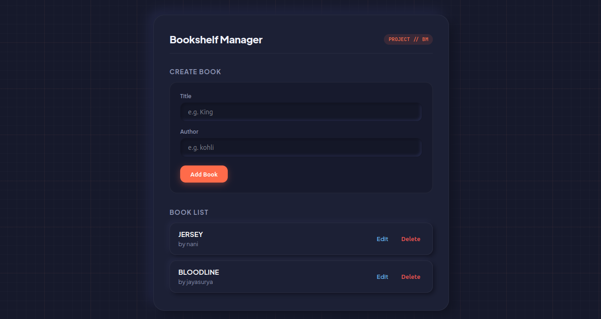

# Bookshelf Manager (Node.js & Mongoose CRUD)

A full-stack bookshelf management web application built with Node.js, Express, MongoDB, and Mongoose featuring an industrial blueprint layout.

---

## 📸 Application Preview



---

## ✨ Features

- Add new book records with Title and Author fields
- Real-time bookshelf directory listing
- In-place record editing using HTTP PUT overrides
- Instant record deletion with HTTP DELETE overrides
- Modular structure separating MongoDB connection logic and Mongoose models

---

## 🛠️ Tech Stack

- **Runtime:** Node.js
- **Backend Framework:** Express.js
- **Database & ODM:** MongoDB & Mongoose
- **View Engine:** EJS
- **HTTP Overrides:** method-override

---

## 🚀 Getting Started

1. Clone the repository and navigate to the directory:
   ```bash
   git clone <YOUR-REPOSITORY-URL>
   cd bookshelf-manager